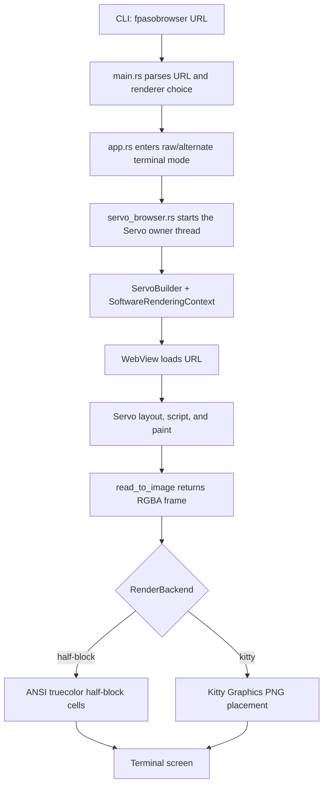
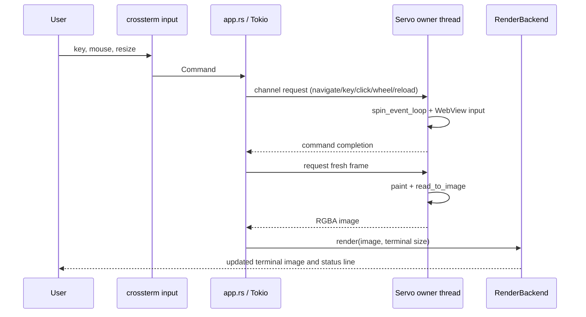
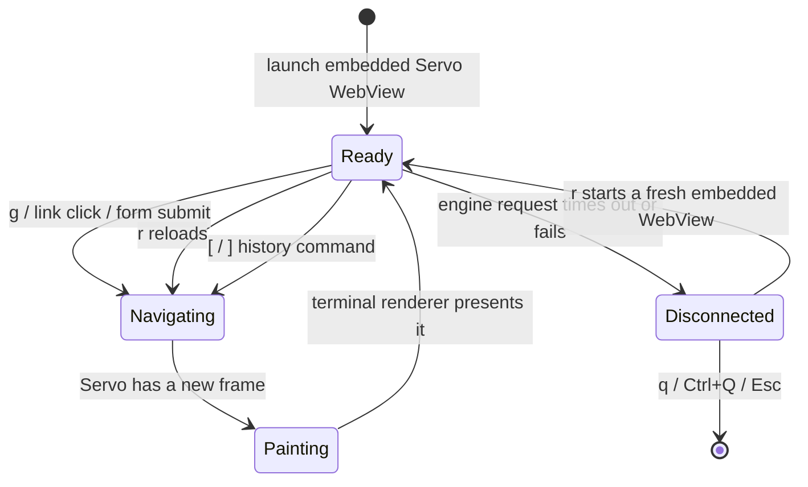
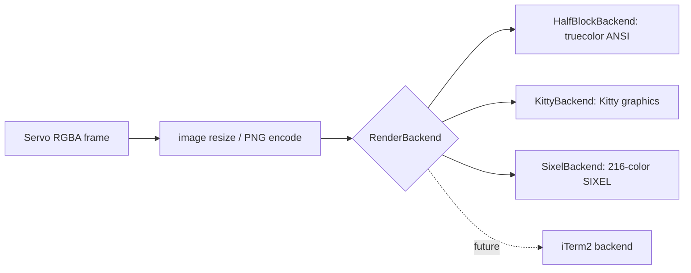

# fpasobrowser processing flows

fpasobrowser is an image-rendering terminal browser, not an HTML-to-text
browser. Servo performs HTML, CSS, JavaScript, layout, and paint work inside
the fpasobrowser process. fpasobrowser reads the resulting RGBA frame and sends
it to the selected terminal renderer.

## Startup and first frame



The WebView and `SoftwareRenderingContext` remain on the Servo owner thread.
The terminal/Tokio loop does not access them directly.

## Command and redraw loop



`r` schedules a reload and redraw. `j`/`k`, arrow keys, and mouse wheel send a
wheel event. `i` places fpasobrowser in browser-input mode; text, `Tab`,
`Shift+Tab`, and `Enter` are forwarded to Servo. The `i` focus request and
cyan focus marker can descend into a same-origin iframe; cross-origin frame
contents are not inspected by page JavaScript. A click that leaves Servo's
parent document focused on an iframe keeps browser-input mode so the child
control receives keyboard input; `Esc` returns to normal mode.

## Navigation and history



Each terminal tab owns a Servo WebView. `t` creates and selects a tab with its
own software rendering context; `{` / `}` select adjacent tabs, and `x` closes
the active tab unless it is the final tab. A page `target="_blank"` or
`window.open()` request creates its auxiliary WebView in the Servo delegate
callback, then the engine loop promotes the completed WebView into a new
selected terminal tab with its own software rendering context. The visible tab
strip also allows direct mouse selection in the same terminal pane. After every
frame capture, the engine returns the active tab's title, URL, history flags,
and load state as one snapshot. The activity line presents that snapshot before
the latest action message; the toolbar renders unavailable history actions as
`(B)` / `(F)`. If the snapshot is still loading, the TUI schedules another
frame refresh; a link-hint popup also reports its newly selected tab number.

## Manual verification handoff

```mermaid
flowchart LR
    A[Site shows CAPTCHA or verification] --> B{User presses o or v on an HTTP(S) URL}
    B --> C[OS default browser opens current URL]
    C --> D[Human completes site-provided verification]
    D --> E[Return to fpasobrowser]
    E --> F[r reloads embedded Servo WebView]
```

The regular browser is a separate session. Its cookies or verification result
are not copied into Servo, and fpasobrowser does not try to evade or solve
CAPTCHA challenges.

## Renderer boundary

`RenderBackend` keeps browser rendering separate from terminal image transport:



This separation lets the browser engine stay embedded while terminal protocol
support evolves independently.
