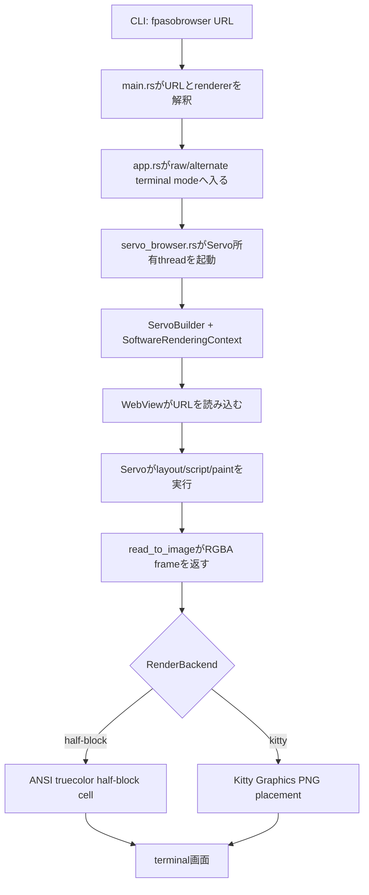
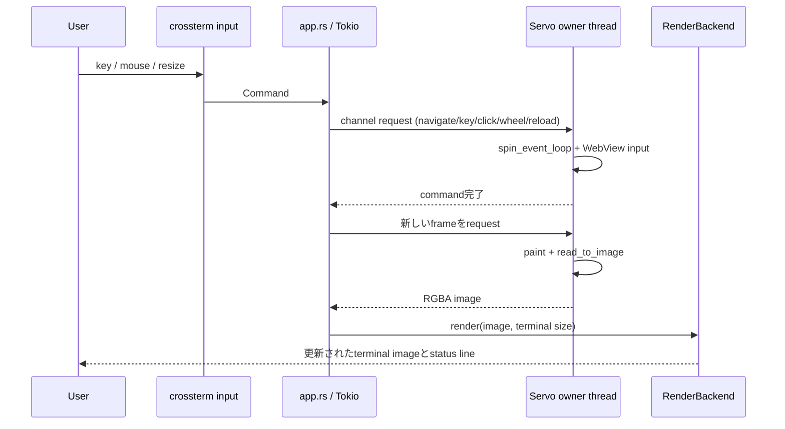
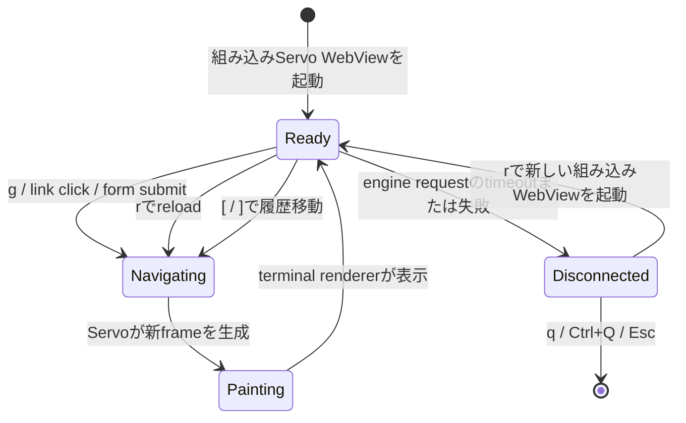
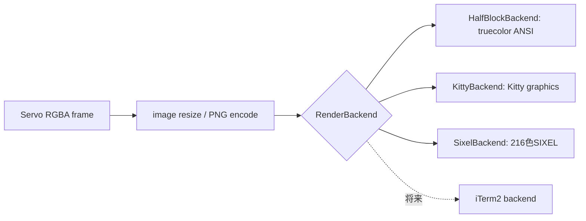

# fpasobrowser 処理フロー

fpasobrowserはHTMLを文字へ変換するtext browserではありません。Servoがfpasobrowser
process内でHTML、CSS、JavaScript、layout、paintを実行し、fpasobrowserが得られたRGBA frameを
terminal用rendererへ渡します。

## 起動と最初のframe



WebViewと`SoftwareRenderingContext`はServo所有threadに留めます。terminal/Tokio loopが
直接これらへアクセスすることはありません。

## commandと再描画loop



`r` はreloadと再描画を予約します。`j`/`k`、arrow key、mouse wheelはwheel eventを送ります。
`i` はbrowser input modeへ入れ、文字、`Tab`、`Shift+Tab`、`Enter`をServoへ転送します。`i` のfocus要求と
水色focus markerはsame-origin iframeの内側まで辿れます。click後にServoが親documentでiframeだけをfocusとして
報告する場合もchild controlへのkey入力を維持するためbrowser input modeを続け、`Esc`でnormal modeへ戻ります。
cross-origin iframeの内容はpage JavaScriptで検査しません。

## 画面遷移と履歴



terminal tabごとにServo WebViewを持ちます。`t` で作成するtabには個別のsoftware rendering
contextを割り当て、`{` / `}` で隣接tabを選択、`x` でactive tabを閉じます（最後のtabは維持します）。
pageの`target="_blank"`または`window.open()`要求はServo delegate callback内でauxiliary WebViewを
生成し、engine loopで独立したsoftware rendering contextを持つ新しい選択済みterminal tabへ昇格します。
画面下部のtab stripをmouseでclickしても、同じterminal pane内でtabを選択できます。frame取得後には
engineがactive tabのtitle、URL、履歴可否、load状態を1つのsnapshotとして返し、activity lineはその状態を
最新action messageの前に表示します。snapshotがloadingならTUIは次のframe更新を予約します。hintでpopupを
作成した場合は新しく選択されたtab番号も表示します。履歴がないtoolbar操作は `(B)` / `(F)` として表示します。

## 手動verificationの引き継ぎ

```mermaid
flowchart LR
    A[siteがCAPTCHA/verificationを表示] --> B{HTTP(S) URL上でuserがoまたはvを押す}
    B --> C[OS標準browserで現在URLを開く]
    C --> D[人がsite提供のverificationを実施]
    D --> E[fpasobrowserへ戻る]
    E --> F[rで組み込みServo WebViewをreload]
```

通常browserは別sessionです。Cookieやverification結果はServoへコピーされず、fpasobrowserは
CAPTCHAの回避・自動解決を行いません。

## rendererの境界

`RenderBackend`によりbrowser描画とterminal画像転送を分離します。



この分離により、browser engineを組み込んだままterminal protocolの対応を独立して拡張できます。
